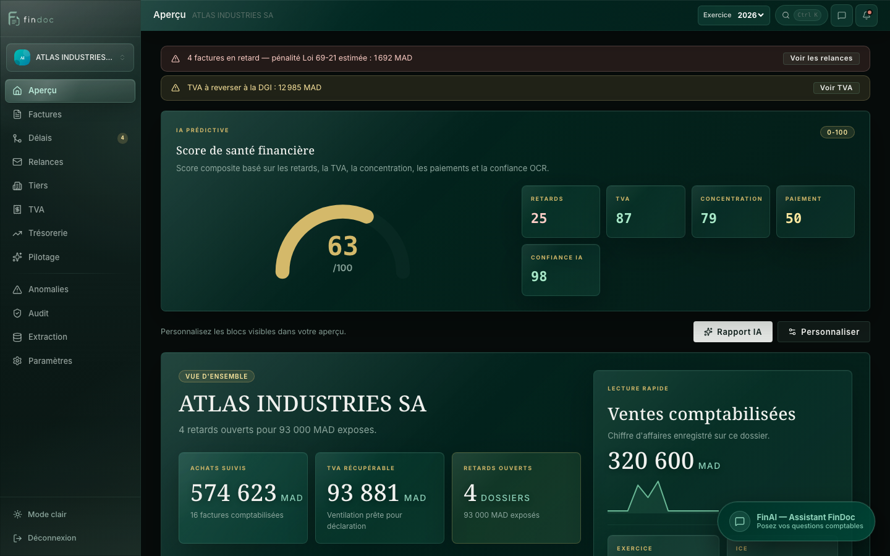
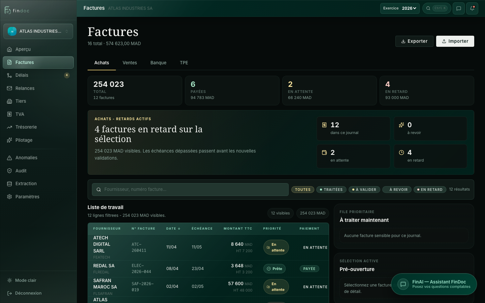

# Findoc

**AI-assisted bookkeeping for Moroccan accounting firms.**
Findoc turns supplier and client invoices into ready-to-post journal entries under the Moroccan chart of accounts (PCM), tracks payment delays under Law 69-21, and gives accountants a per-client finance cockpit.



## Features

- **Invoice extraction**: upload a PDF or image. Text is read with `pdfplumber`, then Claude extracts the supplier, amounts, VAT, dates and invoice number, each with a confidence score.
- **Journal entry generation**: each invoice becomes balanced PCM entries (401100 / 344100 / 6xxx for purchases, 342100 / 342200 / 7xxx for sales). Foreign suppliers get the 10% withholding tax (RAS) automatically.
- **Explainable AI**: the invoice drawer shows why the model picked each account and VAT rate, and the accountant can correct it before validating.
- **Learning from corrections**: past corrections are embedded and retrieved (RAG) to steer later extractions.
- **Law 69-21 late-payment penalties**: overdue invoices are flagged and penalties computed as
  `TTC × (BAM rate + 3%) × max(0, days_late − 60) / 365`.
- **Company onboarding from documents**: drop a company registration PDF, image or XML and the ICE, IF, RC, CNSS, capital, legal form and address are pre-filled with Claude Vision.
- **Finance cockpit**: a financial health score, VAT due, cash forecast, anomaly detection, customizable widgets and a monthly AI report.
- **Operations**: bank reconciliation, payment reminders, XLSX export, an in-app assistant (FinAI) and an admin console.



## Architecture

```
┌──────────────────────┐      REST / JWT      ┌──────────────────────────┐
│  React 19 + Vite     │ ───────────────────▶ │  FastAPI  (backend/)     │──▶ Claude API
│  frontend/           │                      │  SQLAlchemy · SQLite     │    (extraction, entries,
│  Recharts, Router 7  │                      │  pdfplumber · openpyxl   │     chat, reports)
└──────────────────────┘                      └──────────────────────────┘
          │                                                │
          │  fallback                                      ▼
          │                                   ┌──────────────────────────┐
          └─────────────────────────────────▶ │  Express  (backend-node/)│
                                              │  same SQLite database    │
                                              └──────────────────────────┘
```

| Layer | Stack |
|-------|-------|
| Frontend | React 19, Vite, React Router 7, Recharts, Vitest |
| API | Python FastAPI, SQLAlchemy, JWT (python-jose + bcrypt) |
| AI | Anthropic Claude (Sonnet, configurable via `ANTHROPIC_MODEL`), pdfplumber, ChromaDB for the RAG |
| Data | SQLite |
| Deploy | Vercel (frontend), Railway (Node API), Docker Compose for self-hosting |

### Design choices

- **Two backends.** The FastAPI service holds the AI and accounting logic. A lightweight Express service reads the same SQLite file, so the demo stays online on a free Railway instance even when the Python stack is not deployed.
- **Mock data layer.** When the frontend runs without an API (`VITE_API_URL` unset, non-local host), it serves seeded demo data, so the Vercel preview always works.
- **Accounting rules live in code, not prompts.** Claude extracts and proposes entries. The PCM mapping, VAT, RAS and penalty maths are deterministic Python (`backend/services/export.py`, `backend/services/claude.py`).

## Getting started

Requirements: Node 20+, Python 3.11+.

```bash
# 1. API (Python)
cd backend
python -m venv .venv && source .venv/bin/activate
pip install -r requirements.txt
cp ../.env.example .env        # add your ANTHROPIC_API_KEY
uvicorn main:app --reload       # http://127.0.0.1:8000/docs

# 2. Frontend
cd frontend
npm install
npm run dev                     # http://localhost:5173
```

The Node backend works without Python dependencies: `cd backend-node && npm install && npm start`.

A demo database with one company (**ATLAS INDUSTRIES SA**: 16 invoices, 52 journal entries, 4 overdue invoices) ships in `backend/findoc.db`. To regenerate it, run `python backend/scripts/seed_demo.py`.

Demo login: `ziyad@cabinetchami.ma` / `password123`.

Docker: `docker compose up --build`.

## Project structure

```
backend/
  main.py              FastAPI app and startup migrations
  models/              SQLAlchemy models (User, Dossier, Facture, Ecriture, …)
  routers/             auth, dossiers, factures, reconciliation, relances, chat, learning, admin
  services/            Claude extraction, entry generation, RAG, bank AI, XLSX export
  scripts/seed_demo.py demo data
backend-node/          Express fallback API
frontend/src/
  api/                 axios client and mock data
  pages/               Dossiers, Dashboard, Admin
  components/          Shell, invoice workspace, drawers, widgets
docs/                  deployment notes and screenshots
```

## Tests

```bash
cd frontend
npm test
```
